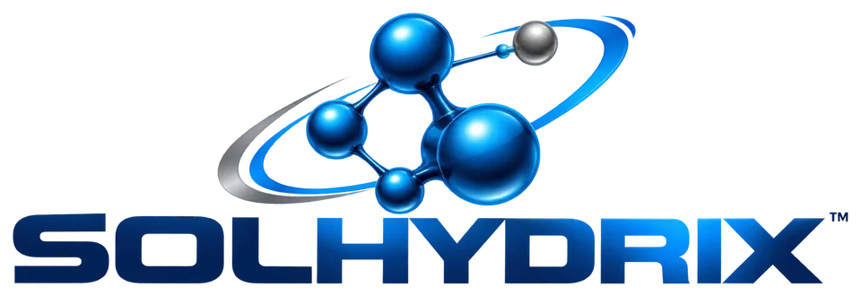
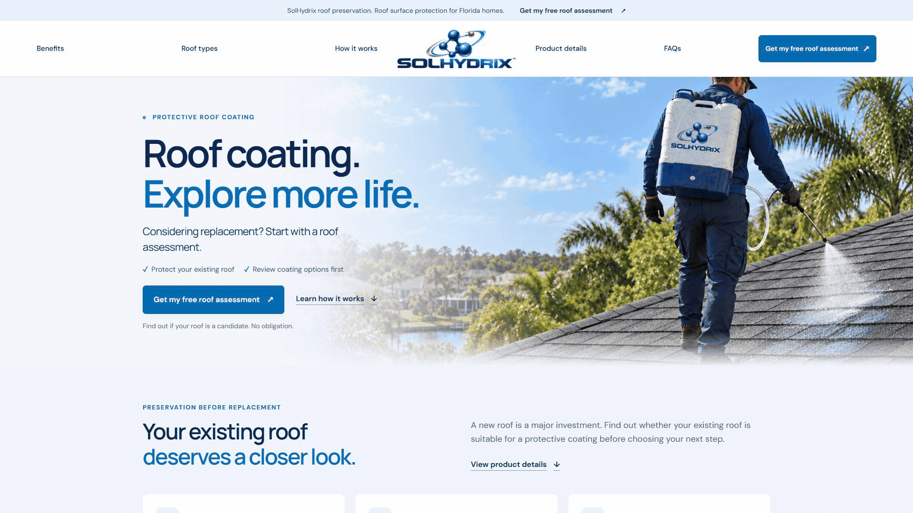
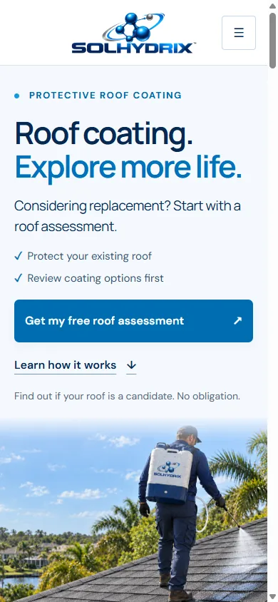
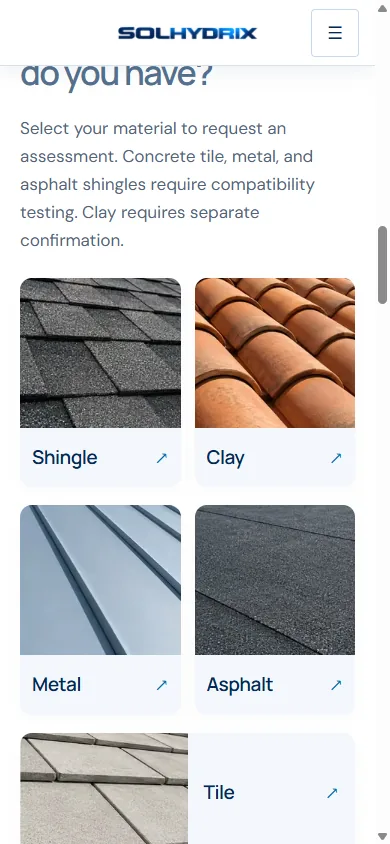
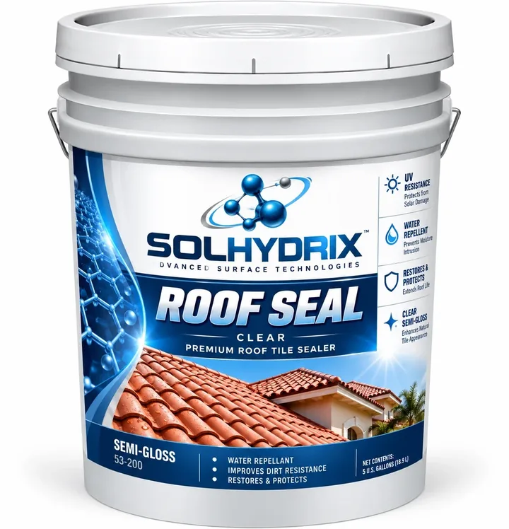

<h1 align="center">SolHydrix website case study</h1>

<strong>Roof coating. Explore more life.</strong> Brand direction, WordPress experience, marketing copy, responsive design, SEO, and performance work for a Florida roof coating concept.

<strong><a href="https://rawpowered.github.io/SolHydrix-Showcase/">Open the interactive HTML demo</a></strong> · <a href="assets/solhydrix-scroll-1080p.mp4">Watch the 1080p video</a> · <a href="assets/solhydrix-scroll-1080p.gif">Download the 1080p GIF</a>

<a href="#the-experience">Experience</a> · <a href="#design-decisions">Design decisions</a> · <a href="#implementation-evidence">Implementation evidence</a> · <a href="#review-by-discipline">Review by discipline</a>

Full page scroll captured at 1920 × 1080. The linked demo is a static portfolio preview.

## Project at a glance

SolHydrix is a separate WordPress site developed around an approved blue molecular logo and Roof Seal Clear bucket mockup. The page introduces the roof coating, helps visitors identify their roof material, explains the assessment process, and offers a direct request form. The current build is a local preview. The public domain and final product formulation remain pending.

The [interactive HTML demo](https://rawpowered.github.io/SolHydrix-Showcase/) presents the design without WordPress. Its assessment area is a visual preview and does not send or store information. The financing page links to the blank fillable PDF. The static demo is excluded from search indexing to avoid competing with the future SolHydrix domain.

**My contribution:** site structure, responsive visual direction, copy revision, WordPress theme implementation, media preparation, technical claim review, SEO metadata, page speed work, and review evidence. AI-assisted imagery was directed and revised against the brand and application requirements. Official logo and bucket files were supplied for the project.

| Audience | Start here |
| --- | --- |
| Site stakeholders | [Desktop and mobile experience](#the-experience), [launch status](#launch-status) |
| Design and web development reviewers | [Visual rejection study](showcase/rejected-artwork/README.md), [responsive layout](#the-experience), [code examples](examples/README.md) |
| AI Tutor and design QA reviewers | [Rejection criteria and corrections](showcase/rejected-artwork/README.md), [copy decisions](showcase/copywriting/README.md), [optimization review](showcase/optimizations/README.md) |
| SEO and performance reviewers | [Measurement and implementation notes](showcase/optimizations/README.md), [selected source excerpts](examples/README.md) |

## The experience

<table>
<tr><td width="50%"></td><td width="50%"></td></tr>
</table>

The page uses a centered logo with balanced navigation, a compact animated wordmark during scroll, large reading sizes, and one clear primary action. The roof cards connect material selection to the assessment form. Product details remain expandable so a visitor can read them when useful.

The approved bucket supplies the visual foundation. Its printed performance copy remains subject to manufacturer confirmation. Website claims use provisional specifications and describe roof life extension as a development goal rather than a measured outcome.

## Design decisions

| Decision | Reason |
| --- | --- |
| Blue and white brand palette | Connects the approved logo and packaging to a light, Florida-oriented page. |
| Direct roof coating headline | States the category immediately and gives search engines a clear H1. |
| Shingle application image | Shows the material used in the main presentation and fits the assessment journey. |
| Assessment before recommendation | Roof condition, repairs, and compatibility affect whether treatment is appropriate. |
| Provisional specifications in a detail section | Gives technical readers useful facts while keeping the first screen focused on the homeowner's decision. |
| Form and financing separated | The website collects basic assessment details. The blank financing PDF is saved on the visitor's device. |

The [visual rejection study](showcase/rejected-artwork/README.md) records earlier packaging and hero directions. The [copywriting review](showcase/copywriting/README.md) shows how the page moved from broad promises to clearer actions. The [optimization record](showcase/optimizations/README.md) covers SEO, accessibility checks, image delivery, caching, and measurement limits.

## Implementation evidence

The private WordPress source is packaged separately for deployment. This repository contains selected examples of the techniques used, a blank credit application, project visuals, and process documentation. [Read the code examples](examples/README.md).

Local Lighthouse checks after the performance pass scored **99 mobile and 100 desktop for performance**. The mobile run recorded about **2.10 seconds LCP, 0 CLS, and 28 ms total blocking time**. These values are local lab results. Public hosting and real user conditions require fresh measurement. The local SEO score was **66** because indexing is intentionally disabled for the preview.

## Review by discipline

- [Rejected artwork and correction criteria](showcase/rejected-artwork/README.md)
- [Copywriting decisions](showcase/copywriting/README.md)
- [SEO, speed, and accessibility optimization](showcase/optimizations/README.md)
- [Selected WordPress code examples](examples/README.md)
- [Blank fillable credit application](showcase/credit-application/README.md)

## Launch status

The local site is working and the private package is prepared for a staging host. Before the public domain accepts requests, the business must confirm final contact and privacy details, assessment delivery, final manufacturer claims, and the lender workflow. Search visibility stays off until those decisions and destination-domain checks are complete.

## Credits and use

Project site and case study by Joseph Edwards. Official brand files and manufacturer references were supplied for SolHydrix. Application visuals are AI-assisted illustrative work. Earlier images shown in the rejection study are development references. The blank financing PDF is a preliminary intake form with no lender submission or credit authorization.

Portfolio presentation only. The public examples are selected excerpts and do not constitute a distributable WordPress theme or a license to reuse SolHydrix branding. Contact Joseph through the [RawPowered GitHub profile](https://github.com/RawPowered).
