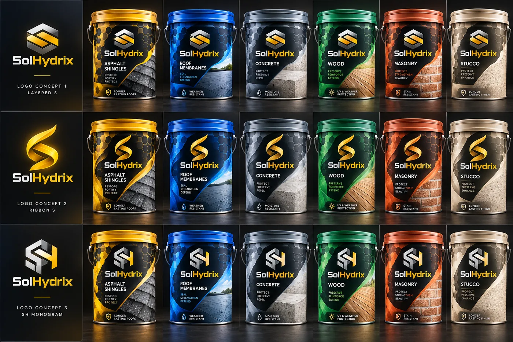

# Visual rejection and correction study

This review documents decisions made while moving from early concepts to the approved SolHydrix presentation. The images are development references. The current site uses the supplied official blue molecular logo and Roof Seal Clear bucket.

## Evaluation criteria

I checked each visual against five questions: Does it match the approved brand? Does it show the intended roof material? Does it depict the application clearly? Does its lighting feel credible? Could visible packaging language be mistaken for a verified product claim?

| Development reference | Review finding | Direction applied |
| --- | --- | --- |
| [Yellow logo and bucket sheet](../../assets/rejected-yellow-concepts.webp) | The yellow families established a coherent early system, yet the later approved logo and bucket use a different identity. The concept labels also contain claims that require verification. | Use the official blue logo and white bucket across the site. Archive these concepts as design history. |
| [Layered S logo](../../assets/rejected-layered-s.webp) and [Ribbon S logo](../../assets/rejected-ribbon-s.webp) | Both marks were explored before the final identity was supplied. | Keep the official molecular logo as the active site identity. |
| [First application hero](../../assets/rejected-tile-hero.webp) | The roof reads as tile, the harness is prominent, and the equipment branding appears unusually pristine. | Shift the hero to asphalt shingles and make the equipment feel integrated with the scene. |
| [Natural light revision](../../assets/rejected-natural-hero.webp) | Lighting and wear improved. The roof material and harness still directed attention away from the intended shingle coating story. | Retain the more natural photographic treatment and correct the roof/application composition. |

### Early yellow packaging system

The panel was useful for comparing material categories and logo shapes. It was removed from the active page when the approved brand was supplied. Concept packaging must not be read as final product labels.

### Hero revision

<table><tr><td width="50%">
Early image: tile material and staged equipment presentation.
</td><td width="50%">
Current image: shingle material, brighter Florida setting, and less distracting branding.
</td></tr></table>

These are illustrative images. They demonstrate art direction and review of generated media. They do not document a real installation or provide product performance evidence.

## AI Tutor review value

The useful skill here is explicit critique. A revision request named the visible issue, connected it to the page goal, and stated a testable correction. I used material fidelity, brand consistency, photographic plausibility, and claim accuracy as separate review criteria. Each criterion could be checked in the next image or page capture.
